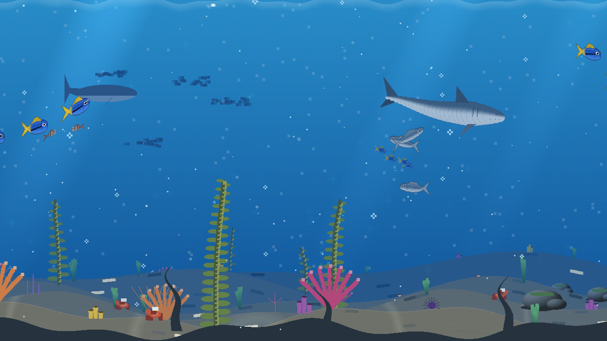
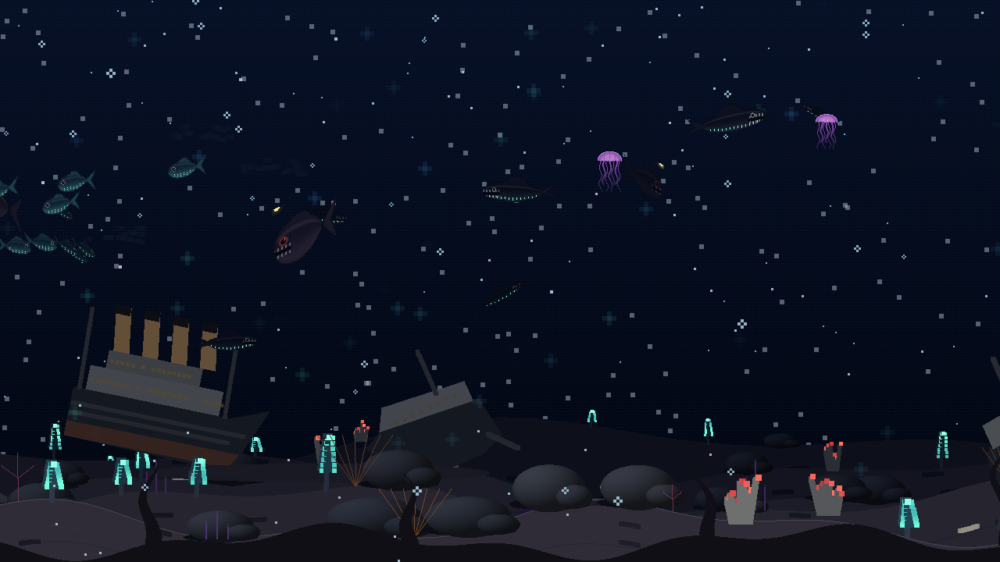

# Abyss

[](https://github.com/cesarfilho/omarchy-abyss/actions/workflows/ci.yml) [](LICENSE)

A gamified deep-sea screensaver for [Omarchy](https://omarchy.org/). A pixel-art ocean runs in your terminal while you are away, evolves with your idle time and earns XP, trophies and points. A shell plugin starts it when you go idle and shows your stats from the bar.

*Português: [README.pt-BR.md](README.pt-BR.md)*


| A shark passes | A shipwreck |
|---|---|
|  |  |

| The liner, 3,800 m down | Christmas lights |
|---|---|
|  |  |

## What it does

- **A living ocean.** Six species of fish (clownfish, blue tang, sardines, lanternfish, vipers, anglers), jellyfish, whales, a **shark** whose body bends as it turns and that makes schools part around it, bubbles, marine snow and bioluminescent blooms, all drawn procedurally. Every school and loner picks its own heading and wanders; followers trail their leader, and fish tilt nose-up or nose-down as they climb or dive.
- **2.5D, and a seabed worth looking at.** Five parallax planes; kelp forests, seagrass, rocks, sea fans, anemones, starfish, urchins and crabs in the shallows, tube worms and glowing sea pens in the deep; rippled sand with caustics and a rippling surface; creatures at different depths (far ones are smaller and hazier).
- **Things on the sea floor.** Shipwreck, submarine, plane, Greek ruins, anchor, treasure chest, amphorae, a whale skeleton, hydrothermal vents and, in the abyssal zone, a broken ocean liner. Each one is a discovery.
- **Several monitors, one sea.** The monitors form a single panorama: a fish that leaves one screen enters the next.
- **Progression.** Every idle minute earns XP. Levels take you down through six zones (Surface, Sunlight, Twilight, Midnight, Abyssal, Hadal) that unlock new species. The reef grows while you are away and wilts if you stay away for days.
- **Bestiary.** Twenty creatures and sights to discover; the first sighting of each is a banner and points.
- **Daily quests.** Three new quests every day (spend time at sea, see a whale, discover a creature, level up…).
- **22 trophies**, streaks and points. Every achievement is a banner over the scene on every monitor; waking the computer shows a summary of what happened.
- **Seasonal events** with 1.5× XP: Jellyfish Night (Oct 24 – Nov 2), Christmas Lights (Dec 20 – Jan 2), Oceans Week (Jun 5–12).
- **Follows your Omarchy theme.** Water, plankton glow and HUD colours lean toward the active theme (`palette: "classic"` turns it off).
- **Light on the machine.** About 18 % of one core at 30 fps on a 1080p screen, 9 % at 15 fps; drawing pauses while the monitor sleeps and drops to 15 fps on battery.
- **Shell plugin.** A bar icon with a stats panel (level, XP, depth, 14-day activity, quests, bestiary, trophies), a switch between Abyss and the stock screensaver, and a resolution selector.

## Requirements

Omarchy (Hyprland + Quickshell) with foot, Alacritty, Ghostty or Kitty as the default terminal; `jq` and `socat` (both ship with Omarchy); `ttfx` for the exit summary (ships with Omarchy). Rust (`cargo`) to build.

## Install

```bash
./install.sh --setup
```

That builds Abyss, installs `abyss`, `abyss-launch`, `abyss-screensaver` and `abyss-setup` to `~/.local/bin`, copies the shell plugin and wires everything into Omarchy. Without `--setup` it only installs; run `abyss-setup enable` when you want to plug it in.

`abyss-setup enable` (idempotent, backs up what it edits):

1. enables the plugin and puts its widget on the right side of the bar;
2. sets `idle.screensaver` to `0` in `~/.config/omarchy/shell.json` so the built-in timer does not also fire (the previous value is saved);
3. points the menu's **Screensaver** item at Abyss (`~/.config/omarchy/extensions/omarchy-menu.jsonc`);
4. restarts the shell.

Then check everything with `abyss doctor`.

To remove it: `./uninstall.sh` (or `abyss-setup disable` to unplug and keep the files). Your progress in `~/.local/state/abyss` is kept unless you pass `--purge`.

### Arch package

`packaging/PKGBUILD` builds the tagged release from GitHub: `cd packaging && makepkg -si` (use `makepkg -p PKGBUILD.dev` to build the current checkout instead). Afterwards run `abyss-setup enable` as your user.

## Usage

```bash
abyss run [--screensaver] [--no-intro] [--monitor NAME]   # run the scene
abyss status [--json]                                     # level, XP, streak, bestiary, quests, trophies
abyss mode [abyss|default|toggle]                         # which screensaver the plugin starts
abyss quality [low|medium|high|ultra|max]                 # resolution (default: ultra)
abyss wake                                                # end it, showing the summary
abyss stop                                                # end it without the summary
abyss doctor [--fix]                                      # check the install; --fix cleans up after a crash
abyss config                                              # print the active configuration
abyss snapshot [zone 0-5] [reef 0-30]                     # print one ANSI frame and exit
```

Any key closes the screensaver. In the bar, click the icon for the stats; right-click switches between Abyss and the stock screensaver.

### Configuration

`~/.config/abyss/config.json` (created on first use; the panel and the CLI both edit it):

| Key | Default | Meaning |
|---|---|---|
| `mode` | `"abyss"` | `"abyss"` or `"default"` (the stock screensaver) |
| `quality` | `"ultra"` | `low` 18 · `medium` 14 · `high` 12 · `ultra` 10.5 · `max` 9 (terminal font size: smaller means a finer pixel grid; the HUD text follows it) |
| `fps` | `30` | frame rate on AC power |
| `battery_fps` | `15` | frame rate while discharging |
| `palette` | `"theme"` | `"theme"` follows the Omarchy theme, `"classic"` keeps the original colours |
| `seasons` | `true` | seasonal events and their XP bonus |

### Data

Progress lives in `~/.local/state/abyss/` (`save.json`, `stats.json`, `last_session.json`, `crash.log`). `save.json` carries a schema version and is migrated when it changes; a file that cannot be read is moved aside as `save.json.corrupt-*`, never overwritten. Delete the folder to start again at level 0.

Environment knobs for testing: `ABYSS_XP_MULT=300` (faster XP), `ABYSS_SEASON=halloween|xmas|oceans` (force an event), `ABYSS_STATE_DIR`, `ABYSS_CONFIG_DIR`, `ABYSS_THEME_FILE`.

## Troubleshooting

`abyss doctor` lists what is wrong and how to fix it. It also warns when Omarchy's own `omarchy-launch-screensaver` changed after `abyss-launch` was copied from it: run `scripts/diff-launch.sh` to see the difference, port what matters, then `abyss-setup record-upstream`.

Nothing happens when idle? `stay-awake` suppresses the idle launch, and `doctor` says whether it is on.

## Development

```bash
cargo build --release
cargo test                          # unit tests: state, world, renderer, socket, config, theme
cargo clippy --all-targets -- -D warnings
cargo test --release bench_frame -- --ignored --nocapture   # where a frame's time goes
scripts/e2e-idle.sh                 # real idle path on your session: plugin -> launcher -> windows -> wake
```

`scripts/e2e-idle.sh --real` waits for the actual idle timer instead (keep your hands off the keyboard). Architecture notes are in [`CLAUDE.md`](CLAUDE.md).

## License

[MIT](LICENSE) © 2026 Cesar Roberto Pamplona Filho.

## Credits

`plugin/abyss-launch` is adapted from Omarchy's `omarchy-launch-screensaver` (MIT, © Basecamp / David Heinemeier Hansson). Ideas for ocean currents, leader-trail schooling and a chained shark body were inspired by [stackedlol/ascii-sharks](https://github.com/stackedlol/ascii-sharks); no code was taken from it.
