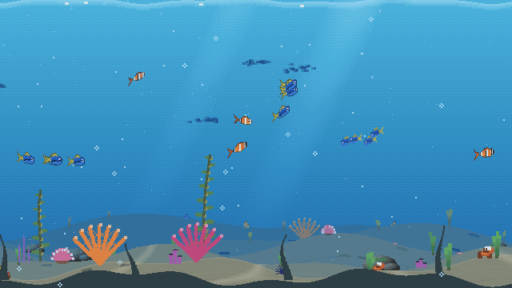
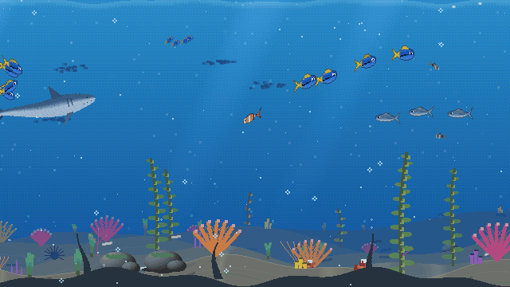
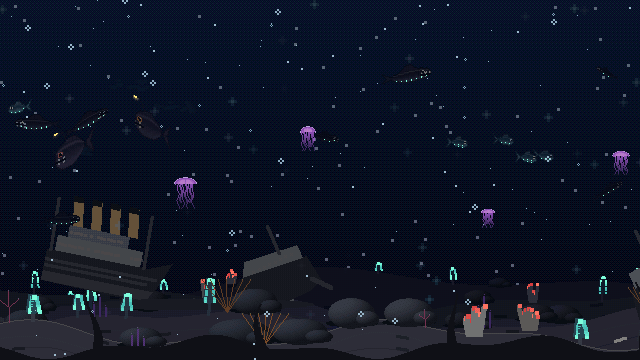
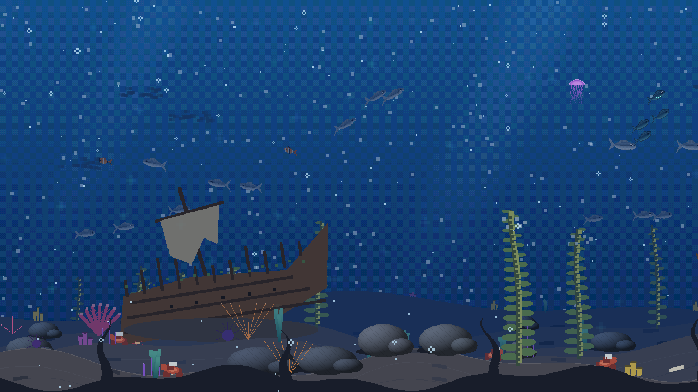
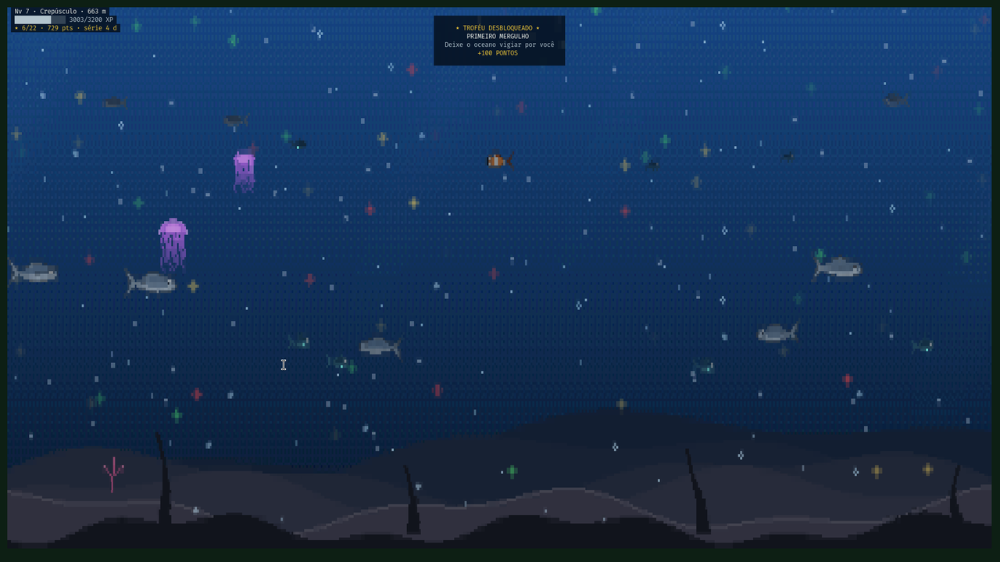

# Abyss

[](https://github.com/cesarfilho/omarchy-abyss/actions/workflows/ci.yml) [](LICENSE)

A gamified deep-sea screensaver for [Omarchy](https://omarchy.org/). A pixel-art ocean runs in your terminal while you are away, evolves with your idle time and earns XP, trophies and points. A shell plugin starts it when you go idle and shows your stats from the bar.

*Português: [README.pt-BR.md](README.pt-BR.md)*

<p align="center"></p>

## What it does

- **A living ocean.** Six species of fish (clownfish, blue tang, sardines, lanternfish, vipers, anglers), jellyfish, whales, a **shark** whose body bends as it turns and that makes schools part around it, bubbles, marine snow and bioluminescent blooms, all drawn procedurally. Every school and loner picks its own heading and wanders; followers trail their leader, and fish tilt nose-up or nose-down as they climb or dive.
- **A seabed worth looking at.** Five parallax planes; kelp forests, seagrass, rocks, sea fans, anemones, starfish, urchins and crabs in the shallows, tube worms and glowing sea pens in the deep; rippled sand with caustics and a rippling surface; creatures at different depths (far ones are smaller and hazier).
- **Things on the sea floor.** Shipwreck, submarine, plane, Greek ruins, anchor, treasure chest, amphorae, a whale skeleton, hydrothermal vents and, in the abyssal zone, a broken ocean liner. Each one is a discovery.
- **Several monitors, one sea.** Fish and seabed features cross between screens in one panorama. Each run visits one of 12 regions inspired by real ocean currents. Its regional current moves the camera steadily while the simulated tide oscillates over 12 h 25 min. Rocks, coral and landmarks keep stable world positions.
- **Sea conditions in the HUD.** An eight-point compass shows the combined current and tide. The panel shows region, speed and tidal phase, alternating wind/waves/visibility with temperature/salinity/pressure. Wind and waves affect the surface; currents move the panorama and particles; occasional upwelling and storms change colour, light, schools and visibility. All values are illustrative simulation values, not local measurements or forecasts.
- **Progression.** Active time earns fixed XP at 0.1 XP/s (6 XP/min), regardless of zone, streak or seasonal event. The current quadratic level curve reaches Hadal after about 31.25 active hours. The reef loses one coral per day after three days away; streaks restart after a missed day.
- **Bestiary and quests.** Twenty creatures and sights to discover (the first sighting of each is a banner and points) and three daily time goals, including 15 minutes active today. Progress is saved across sessions and never depends on random sightings.
- **22 trophies, streaks and points.** Earn one point per active minute plus mission, trophy and discovery rewards. Spend points on three cosmetic palettes (300, 900 and 1,800 points); they do not affect gameplay.
- **Seasonal events** change the visuals and keep their trophies: Jellyfish Night (Oct 24 – Nov 2), Christmas Lights (Dec 20 – Jan 2), Oceans Week (Jun 5–12). They do not change XP.
- **Follows your Omarchy theme.** Water, plankton glow and HUD colours lean toward the active theme (`palette: "classic"` turns it off).
- **Adapts to the display.** Drawing pauses while the monitor sleeps and uses a lower frame rate on battery; resolution and frame rates are configurable.

## Gallery

| A shark passes, the school parts | The liner, 3,800 m down |
|---|---|
|  |  |

| A shipwreck | Christmas lights |
|---|---|
|  |  |

### The shell plugin

A bar icon opens a five-tab panel for your level, depth, activity, quests, bestiary, trophies, cosmetic palettes and settings. Tab switches sections; arrow keys move through the bestiary and trophy grids; Enter opens an entry's description and discovery or unlock progress. Settings include a clear choice of which screensaver starts while idle, the idle delay, resolution, an immediate start action and a confirmed progress reset. The icon tooltip shows the active mode and explains that right-click switches modes.

## Requirements

- Omarchy (Hyprland + Quickshell) with foot, Alacritty, Ghostty or Kitty as the default terminal.
- `jq` and `socat` (both ship with Omarchy); `ttfx` for the exit summary (ships with Omarchy, optional).
- Rust (`cargo`) to build the `abyss` program, or the Arch package below.

## Install

Abyss has two parts: the `abyss` program (draws the sea and keeps your progress) and a shell plugin (starts it when you are idle and shows the panel). Installing the plugin alone does nothing; the panel says so until the program is installed.

### From the Omarchy marketplace

```bash
omarchy plugin add https://github.com/cesarfilho/omarchy-abyss.git --enable
cd ~/.config/omarchy/plugins/io.github.cesarfilho.abyss
./install.sh --setup
```

The first command adds the plugin (the whole repository is cloned into the plugin folder). `./install.sh` builds the program and installs `abyss`, `abyss-launch`, `abyss-screensaver` and `abyss-setup` into `~/.local/bin`; `--setup` also wires Abyss into Omarchy (below). After `omarchy plugin update`, run `./install.sh` again to rebuild the program.

`install.sh` and `uninstall.sh` honor `XDG_DATA_HOME`, `XDG_CONFIG_HOME` and `XDG_STATE_HOME`. Executables use `ABYSS_BIN_DIR` when set and `~/.local/bin` otherwise; add a custom bin directory to `PATH` so the shell can find the commands.

### From a clone

```bash
git clone https://github.com/cesarfilho/omarchy-abyss.git
cd omarchy-abyss
./install.sh --setup
```

Without `--setup` it only installs; run `abyss-setup enable` when you want to plug it in.

### Arch package

`packaging/PKGBUILD` builds the tagged release from GitHub: `cd packaging && makepkg -si` (use `makepkg -p PKGBUILD.dev` to build the current checkout instead). Afterwards run `abyss-setup enable` as your user.

### What `abyss-setup enable` changes

It only runs when you ask for it, is idempotent, and backs up every file it edits (`*.bak.<timestamp>`):

1. enables the plugin and puts its widget on the right side of the bar;
2. sets `idle.screensaver` to `0` in `~/.config/omarchy/shell.json` so the built-in timer does not also fire (your previous value is saved in `~/.config/abyss/setup.json`);
3. points the menu's **Screensaver** item at Abyss (an entry between `abyss-menu-start`/`abyss-menu-end` markers in `~/.config/omarchy/extensions/omarchy-menu.jsonc`);
4. restarts the shell.

Then check everything with `abyss doctor`.

## Remove

```bash
abyss-setup disable                                   # restores idle.screensaver and the menu, removes the bar widget
omarchy plugin remove io.github.cesarfilho.abyss      # removes the plugin folder
./uninstall.sh                                        # from a clone: also deletes the program (add --purge to delete your progress)
```

Your progress in `$ABYSS_STATE_DIR`, `$XDG_STATE_HOME/abyss` or `~/.local/state/abyss`, and settings in `$ABYSS_CONFIG_DIR`, `$XDG_CONFIG_HOME/abyss` or `~/.config/abyss`, are kept unless you pass `--purge`.

## Usage

```bash
abyss run [--screensaver] [--no-intro] [--monitor NAME]   # run the scene
abyss status [--json]                                     # level, XP, streak, bestiary, quests, trophies
abyss mode [abyss|default|toggle]                         # which screensaver the plugin starts
abyss quality [low|medium|high|ultra|max]                 # resolution (default: ultra)
abyss idle [SECONDS]                                      # inactivity delay (default: 150 s)
abyss start                                               # start the configured screensaver now
abyss reset                                               # clear statistics, XP and achievements
abyss wake                                                # end it, showing the summary
abyss stop                                                # end it without the summary
abyss doctor [--fix]                                      # check the install; --fix cleans up after a crash
abyss config                                              # print the active configuration
abyss snapshot [zone 0-5] [reef 0-30] [--ppm FILE] [--t SECONDS] [--size WxH] [--season ID] [--landmark ID] [--region ID]
                                                          # render one frame (ANSI, or a PPM image without touching the screen)
```

Any key closes the screensaver. In the bar, click the icon for the stats; right-click switches between Abyss and the stock screensaver.

`--region` fixes the current in a snapshot: `gulf-stream`, `labrador`, `brazil`, `benguela`, `kuroshio`, `oyashio`, `california`, `humboldt`, `agulhas`, `west-australian`, `east-australian` or `antarctic`. Without it, snapshots retain the previous scene for comparison.

### Configuration

`$ABYSS_CONFIG_DIR/config.json` when set, otherwise `$XDG_CONFIG_HOME/abyss/config.json` or `~/.config/abyss/config.json` (created on first use; the panel and the CLI both edit it):

| Key | Default | Meaning |
|---|---|---|
| `mode` | `"abyss"` | `"abyss"` or `"default"` (the stock screensaver) |
| `quality` | `"ultra"` | `low` 18 · `medium` 14 · `high` 12 · `ultra` 10.5 · `max` 9 (terminal font size: smaller means a finer pixel grid; the HUD text follows it) |
| `fps` | `30` | frame rate on AC power |
| `battery_fps` | `15` | frame rate while discharging |
| `palette` | `"theme"` | `"theme"` follows the Omarchy theme, `"classic"` keeps the original colours |
| `seasons` | `true` | seasonal visuals and trophies |
| `idle_secs` | `150` | inactivity in seconds before the plugin starts the screensaver (10–7200) |

### Data

Progress lives in `$ABYSS_STATE_DIR` when set, otherwise in `$XDG_STATE_HOME/abyss/` or `~/.local/state/abyss/` (`save.json`, `stats.json`, `last_session.json`, `crash.log`). `save.json` carries a schema version and is migrated when it changes; a file that cannot be read is moved aside as `save.json.corrupt-*`, never overwritten. Delete the folder to start again at level 0.

Cosmetic palettes can be managed with `abyss cosmetic buy ID` and `abyss cosmetic select ID`. Environment knobs for testing: `ABYSS_SEASON=halloween|xmas|oceans` (force an event), `ABYSS_STATE_DIR`, `ABYSS_CONFIG_DIR`, `ABYSS_THEME_FILE`.

## Troubleshooting

`abyss doctor` lists what is wrong and how to fix it. It also warns when Omarchy's own `omarchy-launch-screensaver` changed after `abyss-launch` was copied from it: run `scripts/diff-launch.sh` to see the difference, port what matters, then `abyss-setup record-upstream`.

Nothing happens when idle? `stay-awake` suppresses the idle launch, and `doctor` says whether it is on.

## Development

```bash
cargo build --release
cargo test                          # unit tests: state, world, renderer, socket, config, theme, shark, routes
cargo clippy --all-targets -- -D warnings
cargo test --release bench_frame -- --ignored --nocapture   # where a frame's time goes
scripts/e2e-idle.sh                 # real idle path on your session: plugin -> launcher -> windows -> wake
scripts/make-gifs.py                # re-render the README animations
```

`scripts/e2e-idle.sh --real` waits for the actual idle timer instead (keep your hands off the keyboard). Its diagnostic screenshot is created with owner-only permissions in a unique temporary directory and removed when the script exits. Architecture notes are in [`CLAUDE.md`](CLAUDE.md).

After a successful CI run on `main`, GitHub Actions tags the version in `Cargo.toml`, refreshes the release PKGBUILD checksum, and updates the open Omarchy marketplace submission (or opens a verification request for a listed plugin). Configure the repository secret `OMARCHY_MARKETPLACE_TOKEN` with a fine-grained token limited to Issues read/write on `omacom/omarchy-plugin-marketplace`. If the first run skipped because the secret was missing, add it and run the `release-marketplace` workflow once.

## License

[MIT](LICENSE) © 2026 Cesar Roberto Pamplona Filho.

## Credits

`bin/abyss-launch` is adapted from Omarchy's `omarchy-launch-screensaver` (MIT, © Basecamp / David Heinemeier Hansson). Ideas for ocean currents, leader-trail schooling and a chained shark body were inspired by [stackedlol/ascii-sharks](https://github.com/stackedlol/ascii-sharks); no code was taken from it.
