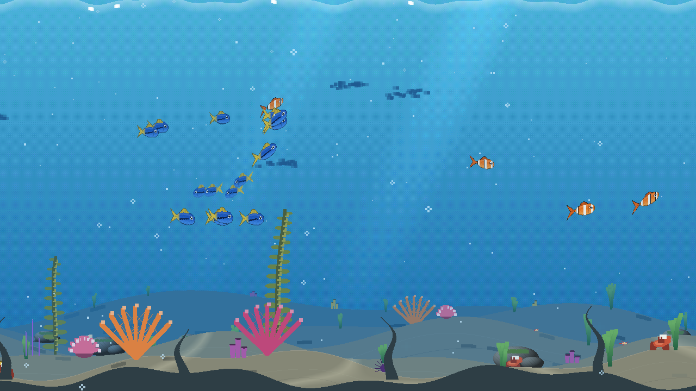
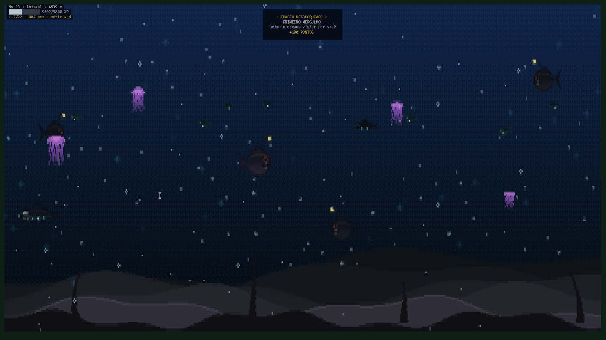

# Abyss

[](https://github.com/cesarfilho/omarchy-abyss/actions/workflows/ci.yml) [](LICENSE)

Screensaver gamificado do fundo do mar para o [Omarchy](https://omarchy.org/). Um oceano em pixel-art roda no terminal enquanto você está longe do computador, evolui com o tempo ocioso e rende XP, troféus e pontos. Um plugin do shell dispara o screensaver na ociosidade e mostra suas estatísticas na barra.

*English: [README.md](README.md)*



| Mar profundo | Evento de temporada |
|---|---|
|  |  |

## O que ele faz

- **Oceano vivo:** seis espécies (peixe-palhaço, cirurgião-azul, sardinha, peixe-lanterna, peixe-víbora, tamboril), águas-vivas, baleias, bolhas, neve marinha e marés bioluminescentes, tudo desenhado proceduralmente.
- **2,5D:** cinco planos de paralaxe no fundo, criaturas em profundidades diferentes (as distantes ficam menores e mais enevoadas), sombras na areia, rochas e algas no primeiro plano.
- **Vários monitores, um só mar:** os monitores formam um único panorama; o peixe que sai de uma tela entra na outra.
- **Progressão:** cada minuto ocioso rende XP. Subir de nível aprofunda o mar por seis zonas (Superfície, Zona de Luz, Crepúsculo, Meia-noite, Abissal, Hadal), que liberam espécies. O recife cresce enquanto você está fora e murcha se você sumir por dias.
- **Bestiário:** nove criaturas para descobrir; o primeiro avistamento de cada uma rende um aviso e pontos.
- **Missões diárias:** três missões novas por dia (tempo no mar, ver uma baleia, descobrir uma criatura, subir de nível…).
- **22 troféus**, série de dias e pontos. Cada conquista aparece como aviso sobre a cena em todos os monitores; ao acordar, um resumo mostra o que aconteceu.
- **Eventos de temporada** com XP ×1,5: Noite das Águas-vivas (24/10 a 2/11), Luzes do Natal (20/12 a 2/1) e Semana do Oceano (5 a 12/6).
- **Segue o tema do Omarchy:** água, brilho do plâncton e HUD puxam para as cores do tema ativo (`palette: "classic"` desliga).
- **Leve:** cerca de 18 % de um núcleo a 30 fps numa tela 1080p, 9 % a 15 fps; o desenho pausa com o monitor apagado e cai para 15 fps na bateria.
- **Plugin do shell:** ícone na barra com painel (nível, XP, profundidade, atividade de 14 dias, missões, bestiário, troféus), chave entre o Abyss e o screensaver padrão e seletor de resolução.

## Requisitos

Omarchy (Hyprland + Quickshell) com foot, Alacritty, Ghostty ou Kitty como terminal padrão; `jq` e `socat` (vêm com o Omarchy); `ttfx` para o resumo ao sair (vem com o Omarchy). Rust (`cargo`) para compilar.

## Instalação

```bash
./install.sh --setup
```

Compila, instala `abyss`, `abyss-launch`, `abyss-screensaver` e `abyss-setup` em `~/.local/bin`, copia o plugin e liga tudo ao Omarchy. Sem `--setup` só instala; rode `abyss-setup enable` quando quiser plugar.

`abyss-setup enable` (idempotente, com backup do que edita):

1. habilita o plugin e põe o widget no lado direito da barra;
2. muda `idle.screensaver` para `0` em `~/.config/omarchy/shell.json`, para o temporizador embutido não disparar junto (o valor anterior é guardado);
3. aponta o item **Screensaver** do menu para o Abyss (`~/.config/omarchy/extensions/omarchy-menu.jsonc`);
4. reinicia o shell.

Depois confira tudo com `abyss doctor`.

Para remover: `./uninstall.sh` (ou `abyss-setup disable` para desplugar e manter os arquivos). Seu progresso em `~/.local/state/abyss` é mantido, a menos que use `--purge`.

### Pacote Arch

`packaging/PKGBUILD` monta a versão publicada (tag no GitHub): `cd packaging && makepkg -si` (use `makepkg -p PKGBUILD.dev` para empacotar este diretório). Depois rode `abyss-setup enable` como seu usuário.

## Uso

```bash
abyss run [--screensaver] [--no-intro] [--monitor NOME]   # roda a cena
abyss status [--json]                                     # nível, XP, série, bestiário, missões e troféus
abyss mode [abyss|default|toggle]                         # qual screensaver o plugin dispara
abyss quality [low|medium|high|ultra|max]                 # resolução (padrão: ultra)
abyss wake                                                # encerra mostrando o resumo
abyss stop                                                # encerra sem o resumo
abyss doctor [--fix]                                      # confere a instalação; --fix limpa restos de uma falha
abyss config                                              # mostra a configuração ativa
abyss snapshot [zona 0-5] [recife 0-30]                   # imprime um quadro ANSI e sai
```

Qualquer tecla fecha o screensaver. Na barra, clique no ícone para ver as estatísticas; o botão direito alterna entre o Abyss e o screensaver padrão.

### Configuração

`~/.config/abyss/config.json` (criado no primeiro uso; o painel e a CLI editam o mesmo arquivo):

| Chave | Padrão | Significado |
|---|---|---|
| `mode` | `"abyss"` | `"abyss"` ou `"default"` (o screensaver padrão) |
| `quality` | `"ultra"` | `low` 18 · `medium` 14 · `high` 12 · `ultra` 10,5 · `max` 9 (tamanho da fonte do terminal: menor = grade de pixels mais fina; o texto do HUD acompanha) |
| `fps` | `30` | quadros por segundo na tomada |
| `battery_fps` | `15` | quadros por segundo na bateria |
| `palette` | `"theme"` | `"theme"` segue o tema do Omarchy, `"classic"` mantém as cores originais |
| `seasons` | `true` | eventos de temporada e o bônus de XP |

### Dados

O progresso fica em `~/.local/state/abyss/` (`save.json`, `stats.json`, `last_session.json`, `crash.log`). O `save.json` tem versão de esquema e é migrado quando muda; um arquivo ilegível é separado como `save.json.corrupt-*`, nunca sobrescrito. Apague a pasta para recomeçar do nível 0.

Variáveis para teste: `ABYSS_XP_MULT=300` (XP mais rápido), `ABYSS_SEASON=halloween|xmas|oceans` (força um evento), `ABYSS_STATE_DIR`, `ABYSS_CONFIG_DIR`, `ABYSS_THEME_FILE`.

## Problemas

`abyss doctor` lista o que está errado e como resolver. Ele também avisa quando o `omarchy-launch-screensaver` do Omarchy mudou depois que o `abyss-launch` foi copiado dele: rode `scripts/diff-launch.sh` para ver a diferença, porte o que importa e depois `abyss-setup record-upstream`.

Nada acontece na ociosidade? O `stay-awake` suprime o disparo, e o `doctor` diz se ele está ligado.

## Desenvolvimento

```bash
cargo build --release
cargo test                          # testes: estado, mundo, renderizador, socket, config, tema
cargo clippy --all-targets -- -D warnings
cargo test --release bench_frame -- --ignored --nocapture   # onde o tempo de um quadro vai
scripts/e2e-idle.sh                 # caminho real de ociosidade na sua sessão: plugin -> lançador -> janelas -> acordar
```

`scripts/e2e-idle.sh --real` espera o temporizador de ociosidade de verdade (não toque no teclado). Notas de arquitetura em [`CLAUDE.md`](CLAUDE.md).

## Licença

[MIT](LICENSE) © 2026 Cesar Roberto Pamplona Filho.

## Créditos

`plugin/abyss-launch` é adaptado do `omarchy-launch-screensaver` do Omarchy (MIT, © Basecamp / David Heinemeier Hansson). As ideias de corrente marinha, cardume em trilha de líder e corpo de tubarão em cadeia foram inspiradas em [stackedlol/ascii-sharks](https://github.com/stackedlol/ascii-sharks); nenhum código foi aproveitado.
