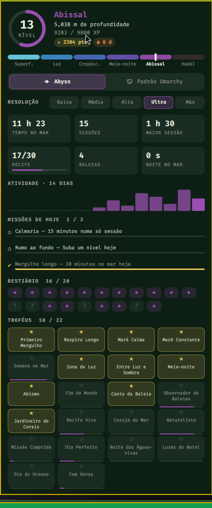

# Abyss

[](https://github.com/cesarfilho/omarchy-abyss/actions/workflows/ci.yml) [](LICENSE)

Screensaver gamificado do fundo do mar para o [Omarchy](https://omarchy.org/). Um oceano em pixel-art roda no terminal enquanto você está longe do computador, evolui com o tempo ocioso e rende XP, troféus e pontos. Um plugin do shell dispara o screensaver na ociosidade e mostra suas estatísticas na barra.

*English: [README.md](README.md)*

<p align="center"></p>

## O que ele faz

- **Oceano vivo:** seis espécies (peixe-palhaço, cirurgião-azul, sardinha, peixe-lanterna, peixe-víbora, tamboril), águas-vivas, baleias, um **tubarão** de corpo articulado que faz os cardumes se abrirem à sua passagem, bolhas, neve marinha e marés bioluminescentes, tudo desenhado proceduralmente. Cada cardume ou peixe solitário escolhe o próprio rumo e passeia; os seguidores vão na trilha do líder e os peixes inclinam o focinho ao subir ou descer.
- **Um fundo que vale olhar:** cinco planos de paralaxe; floresta de algas, capim-marinho, rochas, leques-do-mar, anêmonas, estrelas, ouriços e caranguejos nas águas rasas, vermes-tubo e penas-do-mar brilhantes no fundo; areia ondulada com cáusticas e uma superfície que ondula; criaturas em profundidades diferentes (as distantes ficam menores e mais enevoadas).
- **O que repousa no fundo:** veleiro naufragado, submarino, avião, ruínas gregas, âncora, baú do tesouro, ânforas, esqueleto de baleia, fumarolas hidrotermais e, na zona abissal, um transatlântico partido ao meio. Cada um é uma descoberta.
- **Vários monitores, um só mar:** os monitores formam um único panorama; o peixe que sai de uma tela entra na outra.
- **Progressão:** cada minuto ocioso rende XP. Subir de nível aprofunda o mar por seis zonas (Superfície, Zona de Luz, Crepúsculo, Meia-noite, Abissal, Hadal), que liberam espécies. O recife cresce enquanto você está fora e murcha se você sumir por dias.
- **Bestiário e missões:** vinte criaturas e paisagens para descobrir (o primeiro avistamento de cada uma rende um aviso e pontos) e três missões novas por dia.
- **22 troféus**, série de dias e pontos. Cada conquista aparece como aviso sobre a cena em todos os monitores; ao acordar, um resumo mostra o que aconteceu.
- **Eventos de temporada** com XP ×1,5: Noite das Águas-vivas (24/10 a 2/11), Luzes do Natal (20/12 a 2/1) e Semana do Oceano (5 a 12/6).
- **Segue o tema do Omarchy:** água, brilho do plâncton e HUD puxam para as cores do tema ativo (`palette: "classic"` desliga).
- **Leve:** de 11 a 18 % de um núcleo a 30 fps numa tela 1080p, metade disso a 15 fps; o desenho pausa com o monitor apagado e cai para 15 fps na bateria.

## Galeria

| Um tubarão passa e o cardume se abre | O transatlântico, a 3.800 m |
|---|---|
|  |  |

| Um naufrágio | Luzes do Natal |
|---|---|
|  |  |

### O plugin do shell

Um ícone na barra abre um painel com nível, profundidade, atividade dos últimos 14 dias, missões, bestiário e troféus, uma chave entre o Abyss e o screensaver padrão do Omarchy e um seletor de resolução. O botão direito no ícone alterna entre os dois screensavers.

<p align="center"></p>

## Requisitos

- Omarchy (Hyprland + Quickshell) com foot, Alacritty, Ghostty ou Kitty como terminal padrão.
- `jq` e `socat` (vêm com o Omarchy); `ttfx` para o resumo ao sair (vem com o Omarchy, opcional).
- Rust (`cargo`) para compilar o programa `abyss`, ou o pacote Arch abaixo.

## Instalação

O Abyss tem duas partes: o programa `abyss` (desenha o mar e guarda seu progresso) e um plugin do shell (dispara o programa na ociosidade e mostra o painel). Instalar só o plugin não faz nada; o painel avisa enquanto o programa não estiver instalado.

### Pelo marketplace do Omarchy

```bash
omarchy plugin add https://github.com/cesarfilho/omarchy-abyss.git --enable
cd ~/.config/omarchy/plugins/io.github.cesarfilho.abyss
./install.sh --setup
```

O primeiro comando adiciona o plugin (o repositório inteiro é clonado na pasta do plugin). O `./install.sh` compila o programa e instala `abyss`, `abyss-launch`, `abyss-screensaver` e `abyss-setup` em `~/.local/bin`; o `--setup` também liga o Abyss ao Omarchy (abaixo). Depois de um `omarchy plugin update`, rode o `./install.sh` de novo para recompilar o programa.

### A partir de um clone

```bash
git clone https://github.com/cesarfilho/omarchy-abyss.git
cd omarchy-abyss
./install.sh --setup
```

Sem `--setup` só instala; rode `abyss-setup enable` quando quiser plugar.

### Pacote Arch

`packaging/PKGBUILD` monta a versão publicada (tag no GitHub): `cd packaging && makepkg -si` (use `makepkg -p PKGBUILD.dev` para empacotar este diretório). Depois rode `abyss-setup enable` como seu usuário.

### O que o `abyss-setup enable` altera

Só roda quando você pede, é idempotente e faz backup de cada arquivo que edita (`*.bak.<timestamp>`):

1. habilita o plugin e põe o widget no lado direito da barra;
2. muda `idle.screensaver` para `0` em `~/.config/omarchy/shell.json`, para o temporizador embutido não disparar junto (o valor anterior fica em `~/.config/abyss/setup.json`);
3. aponta o item **Screensaver** do menu para o Abyss (uma entrada entre os marcadores `abyss-menu-start`/`abyss-menu-end` em `~/.config/omarchy/extensions/omarchy-menu.jsonc`);
4. reinicia o shell.

Depois confira tudo com `abyss doctor`.

## Remoção

```bash
abyss-setup disable                                   # devolve idle.screensaver e o menu, tira o widget da barra
omarchy plugin remove io.github.cesarfilho.abyss      # remove a pasta do plugin
./uninstall.sh                                        # num clone: apaga também o programa (--purge apaga seu progresso)
```

Seu progresso em `~/.local/state/abyss` e as configurações em `~/.config/abyss` são mantidos, a menos que use `--purge`.

## Uso

```bash
abyss run [--screensaver] [--no-intro] [--monitor NOME]   # roda a cena
abyss status [--json]                                     # nível, XP, série, bestiário, missões e troféus
abyss mode [abyss|default|toggle]                         # qual screensaver o plugin dispara
abyss quality [low|medium|high|ultra|max]                 # resolução (padrão: ultra)
abyss wake                                                # encerra mostrando o resumo
abyss stop                                                # encerra sem o resumo
abyss doctor [--fix]                                      # confere a instalação; --fix limpa restos de uma falha
abyss config                                              # mostra a configuração ativa
abyss snapshot [zona 0-5] [recife 0-30] [--ppm ARQ] [--t SEG] [--size LxA] [--season ID] [--landmark ID]
                                                          # desenha um quadro (ANSI, ou imagem PPM sem tocar a tela)
```

Qualquer tecla fecha o screensaver. Na barra, clique no ícone para ver as estatísticas; o botão direito alterna entre o Abyss e o screensaver padrão.

### Configuração

`~/.config/abyss/config.json` (criado no primeiro uso; o painel e a CLI editam o mesmo arquivo):

| Chave | Padrão | Significado |
|---|---|---|
| `mode` | `"abyss"` | `"abyss"` ou `"default"` (o screensaver padrão) |
| `quality` | `"ultra"` | `low` 18 · `medium` 14 · `high` 12 · `ultra` 10,5 · `max` 9 (tamanho da fonte do terminal: menor = grade de pixels mais fina; o texto do HUD acompanha) |
| `fps` | `30` | quadros por segundo na tomada |
| `battery_fps` | `15` | quadros por segundo na bateria |
| `palette` | `"theme"` | `"theme"` segue o tema do Omarchy, `"classic"` mantém as cores originais |
| `seasons` | `true` | eventos de temporada e o bônus de XP |

### Dados

O progresso fica em `~/.local/state/abyss/` (`save.json`, `stats.json`, `last_session.json`, `crash.log`). O `save.json` tem versão de esquema e é migrado quando muda; um arquivo ilegível é separado como `save.json.corrupt-*`, nunca sobrescrito. Apague a pasta para recomeçar do nível 0.

Variáveis para teste: `ABYSS_XP_MULT=300` (XP mais rápido), `ABYSS_SEASON=halloween|xmas|oceans` (força um evento), `ABYSS_STATE_DIR`, `ABYSS_CONFIG_DIR`, `ABYSS_THEME_FILE`.

## Problemas

`abyss doctor` lista o que está errado e como resolver. Ele também avisa quando o `omarchy-launch-screensaver` do Omarchy mudou depois que o `abyss-launch` foi copiado dele: rode `scripts/diff-launch.sh` para ver a diferença, porte o que importa e depois `abyss-setup record-upstream`.

Nada acontece na ociosidade? O `stay-awake` suprime o disparo, e o `doctor` diz se ele está ligado.

## Desenvolvimento

```bash
cargo build --release
cargo test                          # testes: estado, mundo, renderizador, socket, config, tema, tubarão, rotas
cargo clippy --all-targets -- -D warnings
cargo test --release bench_frame -- --ignored --nocapture   # onde o tempo de um quadro vai
scripts/e2e-idle.sh                 # caminho real de ociosidade na sua sessão: plugin -> lançador -> janelas -> acordar
scripts/make-gifs.py                # renderiza de novo as animações do README
```

`scripts/e2e-idle.sh --real` espera o temporizador de ociosidade de verdade (não toque no teclado). Notas de arquitetura em [`CLAUDE.md`](CLAUDE.md).

## Licença

[MIT](LICENSE) © 2026 Cesar Roberto Pamplona Filho.

## Créditos

`bin/abyss-launch` é adaptado do `omarchy-launch-screensaver` do Omarchy (MIT, © Basecamp / David Heinemeier Hansson). As ideias de corrente marinha, cardume em trilha de líder e corpo de tubarão em cadeia foram inspiradas em [stackedlol/ascii-sharks](https://github.com/stackedlol/ascii-sharks); nenhum código foi aproveitado.
